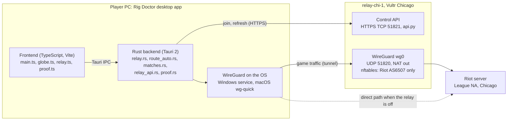

# Rig Doctor onboarding

As of 2026-11-07. Living copy: [Rig Doctor onboarding](https://claude.ai/artifact/ES6bixq569pVUvGdM2m3Jx).

## What Rig Doctor is

Rig Doctor is a game-traffic relay for League of Legends NA that proves its own value: every match is measured direct vs relay, and any month with no measured gain is refunded automatically. The goal is "do the whole relay thing better than anyone else". Competitors sell ping reduction without proof. We sell proof first.

- **Product:** a Tauri desktop app (Windows and macOS) that shows the route on a globe, picks direct or relay per path, and logs proof.
- **Relay:** a WireGuard server on Vultr Chicago that forwards only Riot traffic (AS6507).
- **Origin:** the repo started as a Claude Code plugin that diagnoses Windows gaming PCs (`skills/rig-doctor/SKILL.md`, PowerShell `tools/` and `tests/`). That plugin still ships and is CI-tested.
- **Business shape:** $4.99/mo target, no-card trial, one-click cancel, auto-refund. Hosting costs about $0.03 to $0.15 per player per month. Break-even is about 25 subscribers.
- **Ship rule:** a relay must beat direct by at least 10 ms in-game before we push pricing and signup. Otherwise rethink placement.

## Architecture

The desktop app does all measuring and deciding. The relay is a thin WireGuard box that forwards only Riot traffic, plus a small HTTPS API for joining.



The app talks to the relay twice: once over HTTPS to join or refresh its config, and then over WireGuard for game traffic. With the relay off, game traffic goes direct.

| Part | Where | What it does |
| --- | --- | --- |
| Frontend | `desktop/src/*.ts` | Globe map (globe.gl + three), Relay panel, Proof panel. Renders only. |
| `relay.rs`, `relay_windows.rs`, `mac_helper.rs` | `desktop/src-tauri/src/` | Import, store and toggle the tunnel. Windows uses a SYSTEM service with config in ProgramData. Mac uses Homebrew wg-quick or the signed SMAppService helper. Refuses On while a match runs (Auto and CLI). |
| `route_auto.rs`, `matches.rs` | same | Auto pick. Reads League `netstats.csv` into `match-log.jsonl`. |
| `proof.rs` | same | Writes proof records and the monthly refund verdict. |
| `relay_api.rs`, `wgconf.rs` | same | Joins a relay with an invite. Keys are made on the device, only the public key is sent. Refreshes Riot prefixes before Connect. |
| `geoip.rs`, `lib.rs`, `platform.rs` | same | Offline DB-IP Lite GeoIP, connection list, trace and ping per OS. |
| Relay server | `relay/` | `setup.sh` turns Ubuntu 24.04 into the relay: wg0 on 10.66.66.0/24, nftables egress only to AS6507 prefixes (refreshed daily from RIPEstat), host firewall, key-only SSH. |
| Control API | `relay/api.py`, `relay/billing.py` | Python stdlib HTTPS server, pinned self-signed cert. `rig-relay-invite NAME` makes a one-time invite valid 24 h (never billed). `rig-relay-invite --signup` makes a reusable signup code: 7-day no-card trial, then $4.99/mo through Stripe Checkout, one-click cancel, auto-refund (see Proof and refunds). Endpoints: enroll, config, health, delete peer, billing. Billing is off until Stripe keys are in `/etc/rig-relay/billing.env`. |
| Plugin | `skills/`, `tools/`, `tests/` | The original Claude Code PC-diagnosis skill. Independent of the app. |

App data lives in the OS app-data folder: `relay/saved/` (one entry per relay), `match-log.jsonl`, `proof-log.jsonl`.

## How Auto picks a route

For League, Auto decides on real in-game ping from match logs, not ping probes, and it takes the relay only when the relay wins by 10 ms or more.

1. After each match, the app reads League's `netstats.csv` (written every 10 s with the real RTT) and appends one record per match to `match-log.jsonl`, tagged with the path used (direct or a relay).
2. `route_auto::by_matches` takes the newest 10 matches per path (`RECENT_MATCHES`) and scores each path as median + 3 ms per 1% loss.
3. It needs at least 3 matches on direct AND on the relay (`MIN_MATCHES`). With fewer, it stays direct and says what is missing.
4. The relay wins only if it beats direct by `AUTO_MIN_GAIN_MS` = 10 ms. Proof uses the same bar (`PROOF_MIN_GAIN_MS`), kept equal by a Rust test.
5. Auto switches the tunnel at most once to apply its pick, and only behind the game guard (no switch while a match runs). Probe pings are shown for display only.

**Proof and refunds.** Auto runs are saved to `proof-log.jsonl` with the numbers they voted on. A month with any League matches is judged on matches alone: fewer than 3 per path, or no 10 ms gain, means a refund is due. After the month ends, the app sends that verdict to the relay, which refunds the month's Stripe invoice when it shows no gain, or when no verdict arrives within 3 days. Invoices start on the 1st (UTC), so one invoice is one calendar month. A signup player whose trial or subscription ends is suspended from `wg0` but keeps the API.

**Other games.** Non-League paths still use the older probe scorer (`choose`): median + 0.5 x p95 jitter + 3 ms per 1% loss, decided on the live game server when it answers ping, else by majority of Riot hosts.

Spec: [Auto route selection](https://claude.ai/artifact/R9ZNi273YdiGCKqQZavXWW).

## Dev setup and running

Clone the repo, install WireGuard from your OS package manager, then run `pnpm tauri dev` in `desktop/`. The app opens one window, "Rig Doctor Globe", on port 1420.

```bash
git clone https://github.com/stitts-dev/rig-doctor.git
cd rig-doctor/desktop
pnpm install
pnpm tauri dev          # app window, Vite on 1420
pnpm build              # tsc + vite (validates CSP)
cd src-tauri && cargo test --locked
```

**Toolchain.** Rust 1.97.0 is pinned in `desktop/src-tauri/rust-toolchain.toml`. Node 22 and pnpm 10 match CI.

**WireGuard: package manager only.** Mac uses Homebrew `wireguard-tools`. Windows uses the official installer (`winget install WireGuard.WireGuard`). Never ship an app-copied root helper or a sudoers rule.

**Machines.**

| Machine | OS | Role |
| --- | --- | --- |
| Toaster | Windows | Jaden's gaming PC. League runs here. Live tests, match logs, relay SSH key, Vultr API key (env var). |
| m3 | macOS | Mac build and Mac relay peer. |
| relay-chi-1 | Ubuntu 24.04 on Vultr Chicago | The only relay. Its address lives only on Toaster, never in the repo. |

Only one `pnpm tauri dev` at a time on Toaster. Restarting the dev window never needs a check with Jaden.

**CLI.** The app binary doubles as a CLI that prints JSON: `rig-doctor-globe --relay import|up|down|status|ping|list|use|auto|join|refresh|health|leave`.

**Plugin.** PowerShell tests run with `powershell -NoProfile -File tests\Invoke-SkillTests.ps1` (also `Invoke-DriftGuardTests.ps1`, `Invoke-RelayGainCheckTests.ps1`).

## CI and release

CI is five workflows, each filtered to the paths it covers. Pushing a `desktop-vX.Y.Z` tag builds a draft release with Windows MSI, NSIS and an Apple Silicon dmg.

| Workflow | Runs | Checks |
| --- | --- | --- |
| `desktop-ci.yml` | PRs and main touching `desktop/` | `versions`, `deny` (cargo-deny licenses + advisories), `check` (pnpm build, cargo test, notices file fresh, Playwright overlap check), `macos`, `windows` |
| `relay-ci.yml` | PRs touching `relay/` | shellcheck + netns end-to-end test with real WireGuard and an invited player |
| `test.yml` | every push and PR | PowerShell plugin tests |
| `desktop-release.yml` | `desktop-v*` tag | version job sets the version from the tag, builds Windows and macOS, attaches to a draft release |
| `pages.yml` | PRs and main touching `site/` | checks the landing page's local files, deploys `site/` to GitHub Pages from main |

- **Version comes from the tag.** `scripts/desktop-version.mjs` writes it into package.json, tauri.conf.json, Cargo.toml and Cargo.lock in CI. No bump PR.
- **Tags come from Toaster or Jaden.** Cloud sessions get HTTP 403 pushing tags or deleting branches.
- **Mac signing.** Release CI signs and notarizes only when six secrets exist: `APPLE_CERTIFICATE`, `APPLE_CERTIFICATE_PASSWORD`, `APPLE_SIGNING_IDENTITY`, `APPLE_ID`, `APPLE_PASSWORD`, `APPLE_TEAM_ID`. Without them builds are unsigned. The SMAppService helper is bundled only via `tauri.helper.conf.json`.
- **Notices.** After any dependency change, rerun `node scripts/third-party-notices.mjs` or the `check` job fails.
- **Release notes.** `desktop/release-notes/X.Y.Z.md`, when it exists, opens the draft release's body. The install notes follow.
- **Landing page.** `site/` is a static page (no build step). Its download buttons find the newest published `desktop-v*` release through GitHub's API.
- **Status.** Repo files are at 0.2.0 for the `desktop-v0.2.0` tag. The `desktop-v0.1.0` draft was never published. The checks are not yet required on main.

## Working rules

The repo is public, so secrets and real network data never go in it. Everything else here is how Jaden wants work to flow.

1. **No real IPs, keys or invites in the repo or in chat.** Use documentation ranges (192.0.2.0/24, 198.51.100.0/24, 203.0.113.0/24) in fixtures. Riot and Cloudflare public addresses are fine. The relay address, Vultr API key and invite text stay on Toaster.
2. **Merge once CI passes.** Squash-merge your own PR when green. Do not wait for Jaden or CodeRabbit. Do not leave a backlog of open PRs.
3. **No co-author lines** in commit messages.
4. **Scope.** Deliver what was asked. No drive-by refactors or cleanup.
5. **No gratuitous tunnel drops.** Do not ask Jaden whether he is in a game before relay or tunnel changes, but keep the tunnel up where possible and report what you did. In the app, users may toggle On/Off/Connect mid-match with a warning. Auto's own switching and the CLI keep the game-phase guard.
6. **Dependencies from package managers.** WireGuard via Homebrew or the official Windows installer.
7. **Few admin prompts.** Jaden dislikes repeated macOS password prompts. Minimize them and say how many a change adds.
8. **Map style.** Nodes are bordered server boxes, not circles. Routes are 3D arcs that bend with the globe. No overlap of lines, nodes or labels (checked by `desktop/qa/overlap-check.cjs`). Keep the colors, no blue.
9. **Communication.** Concise, findings first, paste-ready commands, one plain list of what waits on Jaden. Always end a report with concrete next steps.
10. **Toaster safety.** Toaster's own Claude safety check blocks purchases, ssh writes to the relay and running web-downloaded code without Jaden's own words. Give him a paste-ready PowerShell command instead.

## Key finding: relay vs direct is a tie for Jaden

In-game, relay-chi-1 measured 29.9 to 31.5 ms against direct 30.5 to 31.4 ms on Jaden's home line: a tie, well under the 10 ms bar. Relay value depends on where the player's ISP hands traffic to Riot.

- **Why it ties.** His ISP hands traffic to Riot in Ashburn (about 22 ms), then Riot's own backbone carries it to the Chicago game server. The relay path reaches Vultr Chicago in 26 ms (best 21) and enters Riot at the Equinix Chicago exchange. Both end up about the same.
- **Ping probes mislead.** The Riot hosts that answer ping are in Ashburn, LA and Seattle, not Chicago. The Chicago game server drops ICMP and UDP probes. This is why Auto now decides on match logs.
- **No better placement found.** Vultr Atlanta measured 37 ms and Dallas 57 ms. The relay box itself is healthy (kernel WireGuard, MTU 1420, fq_codel, idle).
- **Product consequence.** Find players whose ISP enters Riot late or far away. `tools/relay-gain-check.ps1` estimates a tester's gain with no tunnel or network change.
- **Market context.** NA League gains are small for most players, nobody ties refunds to measured gain, and $4.99 is the market floor.

## Known poor decisions

Most early shortcuts are fixed. Five remain open, and the biggest is that direct and relay are still measured one after the other, so drift can read as gain. Codes F1 to F18 come from the [architecture review](https://claude.ai/artifact/UwyMkREejCMsohs32BTkb1).

**Still open**

| Decision | Why it was wrong | Status |
| --- | --- | --- |
| Direct and relay measured in sequential ~50 s blocks (F2) | Any drift between blocks reads as gain or loss. Probe runs also spawn one OS `ping` per sample (F4). | Open. Fix is interleaved A/B with the tunnel up and interface-bound direct probes. League Auto sidesteps it by using match logs. |
| Tunnel carries all of Riot's AS6507 (F8) | Login, chat, store and patcher ride the relay too: more bandwidth and more anti-cheat surface. | Open. Needs measured League game-server ranges from match logs. Clients pick up a narrower list on refresh. |
| One /24 tunnel subnet per relay | Caps each relay at 253 peers. | Open. |
| Oversized files, refactor skipped (F13, A9) | `main.ts` is 1,974 lines and `relay.rs` 1,553. All panels share module state with hand-escaped `innerHTML`. | Skipped by Jaden's scope rule. Split only when a change needs it. |
| Real network data committed to the public repo (F10) | Home location, ISP hop addresses and LAN layout broke the no-real-IPs rule. | Scrubbed from the tree in #44. Git history still holds it until Jaden runs the purge steps in #44. |

**Fixed**

| Decision | Why it was wrong | What replaced it |
| --- | --- | --- |
| Auto decided League routes on ping probes | The Riot hosts that answer ping are in Ashburn, LA and Seattle, not the Chicago game server. Probes picked on the wrong path. | #64, #65: Auto decides on in-game match logs, probes are display only. |
| Proof written by the UI (F1) | `proof_append` stored any JSON from the webview and TypeScript computed the refund. Unverifiable. | #45: Rust writes the record. Server-side refund per billing period is still to do. |
| Two rules for one question (F3) | Proof used a 5 ms median bar, Auto a 10 ms score bar. One run could say gain and stay direct. | #40, #45: one 10 ms bar, kept equal by a Rust test. |
| Relay generated client keys, peers added over SSH (F7) | Server held client private keys. AllowedIPs went stale after prefix refresh. | #68: control plane on TCP 51821, one-time invites, keys made on device, refresh before Connect. |
| Windows tunnel config user-writable (F5) | Any user-level process could redirect all traffic through the SYSTEM tunnel service. | #48: validated config in ProgramData, user read-only. |
| App-copied root helper and sudoers rule on Mac/Linux (#26) | Broke the package-manager rule and widened root surface. | #36 removed it. #67 adds a signed SMAppService helper (not yet tested on a real Mac, needs Apple secrets). |
| Online GeoIP providers (F9) | ipwho.is and freeipapi free tiers forbid commercial use. | #49: offline DB-IP Lite only. |
| No Windows CI (F11) | The main target never ran `cargo test`. | #46: `windows` job. |
| First relay in New Jersey (relay-ewr-1) | Far from Riot's NA game servers in Chicago. | Destroyed. Vultr Chicago shares Equinix and DE-CIX Chicago with Riot. |

## Open work and references

The next engineering items are interleaved measurement (F2), narrowing the tunnel to League ranges (F8) and lifting the 253-peer cap. Several items wait on Jaden.

**Engineering**

- F2: interleaved A/B measurement with interface-bound direct probes and native ICMP.
- F8: narrow AllowedIPs to League game-server prefixes measured from match logs.
- Relay capacity: more than 253 peers per relay (larger subnet or more relays).
- Mac: confirm the League process name `LeagueofLegends` on a real Mac, and verify the signed helper (one Login Items approval, then zero prompts).
- Second relay to give Auto a real choice (code supports many relays already).
- Multipath packet duplication is held back until a legal review of ExitLag's patent US9992101B2.

**Waiting on Jaden**

- Join Toaster and the Mac to the relay with invites (Relays, Join).
- Run `relay-gain-check.ps1` once on Toaster.
- Play 3+ League matches on relay and 3+ on direct so Auto can decide.
- Apple Developer enrollment, Developer ID cert, the six `APPLE_*` secrets, then a `desktop-v` tag.
- Purge old network data from git history (#44 steps), publish the draft release, make CI checks required on main.

**Existing artifacts**

| Artifact | What it covers |
| --- | --- |
| [Roadmap to a Sellable Product](https://claude.ai/artifact/E6z6wo3GcbD3XdLCDHXGeL) | Sprints, decisions D1 to D10, launch plan |
| [Architecture and code review](https://claude.ai/artifact/UwyMkREejCMsohs32BTkb1) | Findings F1 to F18, actions A1 to A9 |
| [Auto route selection](https://claude.ai/artifact/R9ZNi273YdiGCKqQZavXWW) | How competitors pick routes and our design |
| [Ping Booster Teardowns](https://claude.ai/artifact/4xFrzpnzkgKvBS5MXLfpjn) | ExitLag, WTFast, NoPing and others |
| [Competitors, angle, and profit](https://claude.ai/artifact/Wr2G5gNvHnQK52dFDZCRPm) | Market and margins |
| [Relay Research](https://claude.ai/artifact/AC8nBUrsq9FnQG9s2cXjPj) | Hosting choice, cost per player, viability |
| [Self-hosted relay cost](https://claude.ai/artifact/Ab4sv5U9u8KQDdxUXkZBv8) | VPS cost model |
| [Route Globe UI Audit](https://claude.ai/artifact/6RSvmkYqtHfwgkPPgNG81M) | UI fixes and overlap rules |

In the repo, start with `README.md`, `relay/README.md` and `desktop/src-tauri/src/route_auto.rs`.
